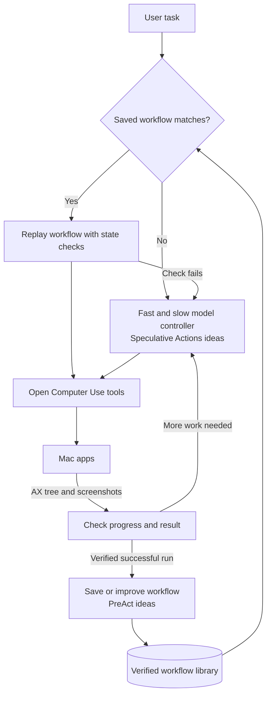

# tinybitsteal

Three repositories for exploring faster computer use: **tools to operate the computer, an architecture for speculative execution, and reusable workflows that make repeated tasks faster.**

This repository contains the three projects as Git submodules, plus research and implementation proposals. The projects are separate; they have not been wired together into one application.

## Fed10 implementation proposal

Read [Speculative retrieval for Fed10 Smart Search](./docs/fed10-speculative-execution.md) for the reviewed staging architecture, worked examples, diagrams, concrete integration points, cache and cancellation rules, and an implementation/test plan.

The proposed first step is to prepare likely exact evidence reads while the main model decides its next calls, then reuse only matching, still-valid results. It is a design proposal, not an implemented or benchmarked Fed10 feature.

## Get everything locally

```sh
git clone --recurse-submodules https://github.com/amoreX/tinybitsteal.git
cd tinybitsteal
```

For a checkout cloned without submodules:

```sh
git submodule update --init --recursive
```

The parent repository is private. The submodules point to their original upstream repositories and pin the exact revisions listed below.

## The three pieces

| Local directory | Repository | What it contributes |
| --- | --- | --- |
| [open-computer-use/](./open-computer-use/) | [Kushagra's Open Computer Use fork](https://github.com/kushagra2503/open-codex-computer-use) | The computer's eyes and hands: observe the UI and execute actions. |
| [speculative-actions/](./speculative-actions/) | [Speculative Actions](https://github.com/naimengye/speculative-action) | The execution architecture: predict upcoming steps and prepare work while authoritative results are pending. |
| [preact/](./preact/) | [PreAct](https://github.com/19PINE-AI/PreAct) | Workflow reuse: turn successful runs into programs that can be replayed with state checks. |

### 1. Open Computer Use: the tools

On macOS, this reads **accessibility trees (AX trees)** and captures screenshots. An AX tree describes interface elements such as buttons, text fields, labels, values, and available actions. The toolkit also clicks, types, scrolls, and sends keyboard input.

An external AI agent calls these tools through MCP or a JavaScript interface. The toolkit itself does not contain a fast/slow model controller or a Speculative Actions integration.

Kushagra forked this from [iFurySt/open-codex-computer-use](https://github.com/iFurySt/open-codex-computer-use). In the published revision cloned here, his fork has no unique commits ahead of upstream.

Start with its [architecture document](https://github.com/kushagra2503/open-codex-computer-use/blob/93b817501e0b9fa04fba155face2630bfcd0322e/docs/ARCHITECTURE.md) and [AX snapshot implementation](https://github.com/kushagra2503/open-codex-computer-use/blob/93b817501e0b9fa04fba155face2630bfcd0322e/packages/OpenComputerUseKit/Sources/OpenComputerUseKit/AccessibilitySnapshot.swift).

### 2. Speculative Actions: prepare likely next steps early

The pattern has two roles:

- A **fast speculator** predicts likely upcoming actions or responses.
- An **authoritative actor** supplies the actual decision or result. This can be a stronger model, but the framework also covers tools and other sources of delayed results.

While the authoritative result is pending, the system starts useful work for predicted outcomes. If the prediction matches, it reuses that prepared work. Otherwise, it follows the actual result.

For example, the chess implementation copies the board, applies a predicted move to the copy, and prepares a response. It only reuses that response when the actual move matches the prediction.

This repository's published examples cover chess, retail tool calls, Wikipedia search, and Linux scheduler tuning. They do not implement AX-tree-based desktop control. We would need to adapt the architecture to Open Computer Use.

Start with the [repository README](https://github.com/naimengye/speculative-action/blob/dc938b9ef7474caf07fe4ad16549c1fa8c7d268c/README.md) and [chess execution loop](https://github.com/naimengye/speculative-action/blob/dc938b9ef7474caf07fe4ad16549c1fa8c7d268c/chess-game/speculative_workflow/Speculative_Chess.py).

### 3. PreAct: remember how to do a task

PreAct converts successful computer-use trajectories into reusable state-machine programs: steps, conditions, and checks describing how to complete a workflow.

On a matching future task, the saved program can execute routine steps without asking an LLM to decide every action. If a state check fails, the agent can take over and improve the workflow.

For example, save a procedure for downloading an invoice, with the month as a parameter. On the next run, check that the expected page and controls exist before following the saved procedure.

This is research code, not a ready-made cache adapter for Open Computer Use. Task matching, environment integration, and reliable success checks still need work.

Start with the [repository README](https://github.com/19PINE-AI/PreAct/blob/0a5c91f96360e3933f7af0746d449ab92d05c743/README.md), [agent](https://github.com/19PINE-AI/PreAct/blob/0a5c91f96360e3933f7af0746d449ab92d05c743/preact/core/agent.py), and [state-machine executor](https://github.com/19PINE-AI/PreAct/blob/0a5c91f96360e3933f7af0746d449ab92d05c743/preact/executor/engine.py).

## How we would connect them

This is the **proposed combined design**, not an integration already present in these clones.



In plain language:

1. Look for a known way to complete the task.
2. If it matches the current UI, replay it with checks.
3. Otherwise, let the models work out the actions, using speculation where useful.
4. Execute through Open Computer Use and observe what actually happened.
5. Save verified successful procedures so similar future tasks take less reasoning.

## Two different kinds of reuse

- **Speculative reuse:** use work already prepared for a predicted outcome during the current run.
- **Workflow reuse:** remember a successful procedure and use it in later runs, which is the PreAct contribution.

[AgenticCache](https://github.com/hojoonleokim/MLSys26_AgenticCache) is another approach: cached plan transitions maintained by a background LLM. It overlaps with controller design. We selected PreAct as the third clone because it more directly addresses “learn this computer workflow once, repeat it faster.”

## What the integration must handle

One executor should own clicks and typing, while model decisions refer to the UI state they observed. An AX snapshot describes the interface; it does not clone the application or make actions reversible. Speculation can prepare reasoning or isolated work, but an action such as sending a message cannot be undone by a reviewer arriving later.

Saved workflows need parameters, UI-state checks, and verified outcomes. They should re-resolve current controls rather than blindly reuse old coordinates or snapshot element numbers. On a mismatch, execution should return to the controller.

## Checkout snapshot

Cloned on **2026-10-14** and preserved as Git submodules, each with its own upstream origin and history. No dependencies have been installed and no applications or model calls have been started for this collection.

| Directory | Branch | Commit |
| --- | --- | --- |
| `open-computer-use` | `main` | `93b817501e0b9fa04fba155face2630bfcd0322e` |
| `speculative-actions` | `main` | `dc938b9ef7474caf07fe4ad16549c1fa8c7d268c` |
| `preact` | `master` | `0a5c91f96360e3933f7af0746d449ab92d05c743` |

Refer to each repository's own documentation and license terms before integrating or redistributing its code.
