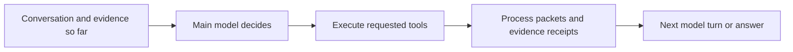
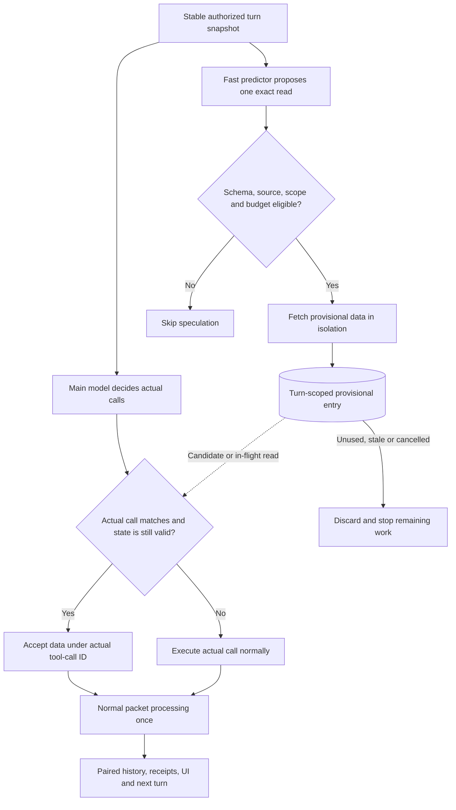

# Speculative retrieval for Fed10 Smart Search

**Status: implementation proposal, not implemented or benchmarked.** Reviewed on 2026-10-14 against Fed10 `staging` at [`c5dddc5fa3d02d3adc9ba317e055af4b7a200a26`](https://github.com/Fed10/fed10/commit/c5dddc5fa3d02d3adc9ba317e055af4b7a200a26). All Fed10 source links below are pinned to that revision and require access to its repository.

## Recommendation

Apply the Speculative Actions pattern to **likely evidence reads while Smart Search's main model is deciding its next tool calls**. Start with one eligible, exact public-record read per turn. Keep the main model responsible for selecting evidence, interpreting it, and answering the user.

A faster model predicts a possible next read. The backend prepares its data concurrently. If the main model requests that exact read and the authorization, source version, and run state still match, reuse the prepared result. Otherwise, execute the main model's requested call normally and discard the unused work.

This is a proposed optimization of Fed10's existing tool pipeline. Open Computer Use is unnecessary for this path because Fed10 already accesses its sources directly. PreAct-style workflow reuse is a separate, later experiment.

**The intended benefit is lower waiting time without changing which evidence the main model receives. That property needs implementation tests; it is not established merely by using two models.**

## 1. How this relates to the three repositories

| Project | What its inspected code does | What to adopt for Fed10 | What to leave out |
| --- | --- | --- | --- |
| [Open Computer Use](https://github.com/kushagra2503/open-codex-computer-use/blob/93b817501e0b9fa04fba155face2630bfcd0322e/docs/ARCHITECTURE.md) | Exposes computer observation and actions, including macOS accessibility trees and screenshots. | Nothing required for native Smart Search retrieval. It could serve a future task that genuinely needs a website or desktop app. | Routing existing database/API reads through a browser, and treating an AX snapshot as a cloned application. |
| [Speculative Actions](https://github.com/naimengye/speculative-action/blob/dc938b9ef7474caf07fe4ad16549c1fa8c7d268c/chess-game/speculative_workflow/Speculative_Chess.py) | Predicts an authoritative action, prepares a continuation in a copied chess environment, and selects a matching continuation after the actual action arrives. | Concurrent preparation, explicit match checks, and fallback to the authoritative path. | The whole research game loop, waiting for every predicted branch, or speculative writes to a shared environment. |
| [PreAct](https://github.com/19PINE-AI/PreAct/blob/0a5c91f96360e3933f7af0746d449ab92d05c743/preact/core/agent.py) | Compiles computer-use traces into state-machine programs, executes programs, and falls back to model-driven work when checks fail. | Later: investigate parameterized procedures with validation for repeated workflows. | Treating its benchmark replay selector as a production task-matching cache. The inspected core replay path loads the first stored program. |
| Fed10's existing runtime | Runs authoritative tool batches, tracks evidence delivery, preloads assigned archives, and prepares context compaction in the background. | Reuse these boundaries and their tests. | A second agent harness that bypasses permissions, receipts, user interruptions, or provider history rules. |

In the Speculative Actions chess example, `_simulate_and_speculate` copies the board before applying a guessed move. `_execute_game_loop` checks the actual move against predictions. Its futures are also joined in ways that can wait for speculative work. Fed10 should borrow the acceptance principle, not copy this scheduling behavior wholesale.

The two roles are **predictor** and **authoritative actor**. The authoritative model still makes the real decision; it is not merely a monitor approving whatever the fast model already published. General speculative execution can also predict a tool response or another delayed event. This proposal specifically predicts the main model's next tool call.

## 2. What Fed10 already does

The shared [agent loop][loop] calls `session.model_turn(state)`, then `session.execute_tools(step.calls)`, then appends the paired results and checkpoints. It verifies that every actual tool call receives a result in the original order.



Multiple safe reads in an actual model response can already run concurrently through [the parallel executor][parallel] and [its eligibility checks][parallel-safety]. The configured tool worker limit is six. This parallelism starts **after** the model has requested the calls; it does not predict them.

Two existing mechanisms are useful precedents:

- [Assigned archive preparation][archive] reads version-bound pages before a delegated reader reasons about them. It validates page boundaries, continuation metadata, and the content digest. The archive is already assigned, so this is ordinary prefetch rather than a prediction of what the model will request.
- [Background context compaction][compaction] prepares work concurrently. [Checkpoint application][checkpoint] checks the original prefix digest before replacing messages. This demonstrates a useful “prepare now, validate before applying” boundary, although it solves a different problem.

The current [message cache helper][message-cache] manages provider prompt caching. It is not a cache of tool results or reusable agent workflows.

## 3. Worked example: find and compare AI bills

User asks: **“Find state AI bills relevant to our product and compare their requirements.”**

Assume an authorized search has returned three candidate records: A, B, and C. The main model has their search summaries and is deciding which full texts it needs. These labels are fictional; an implementation would use exact record IDs returned by search.

| Step | Authoritative path | Speculative path |
| --- | --- | --- |
| 1 | Search results enter the normal conversation and evidence pipeline. | Nothing is predicted before the candidate records are known. |
| 2 | Main model starts deciding what to read. | Fast predictor receives the same stable task/evidence snapshot and guesses an exact read of A. |
| 3 | Main model continues reasoning. | Backend validates eligibility and fetches A into provisional storage. |
| 4 | Main model requests full texts of A and C. | A matches; C has no prediction. |
| 5 | A is delivered through the normal packet path; C is fetched normally. | A's prepared data is consumed once. No invented tool call is inserted into history. |
| 6 | Main model compares the actual evidence and writes its answer. | Predictor has no authority over the answer or citations. |

An illustrative tool call is:

```json
{
  "name": "read",
  "input": {
    "source": "legislation",
    "id": "<exact-record-id-A-from-search>",
    "include": ["text"]
  }
}
```

The placeholder is explanatory, not a valid runnable record ID. The actual schema and defaults must be validated through Fed10's existing tool definitions.

If a later experiment permits two predictions, it might prepare A and B while the main model chooses A and C. Reuse A, discard B, and fetch C normally. **Discarded B must not appear as evidence read by the main model, in citations, or in the user's activity stream.** The initial implementation should use one prediction to keep wasted work and concurrency bounded.

### Example timing

Assume the main decision takes 8 seconds, prediction takes 1 second, and a matching read takes 3 seconds. Ignore overhead and final answer generation for this illustration:

```text
Normal:       main decision 8s -> read 3s                  = 11s
Matching:     main decision 8s ------------------------>  =  8s
              prediction 1s -> provisional read 3s
```

For a hit, the simplified segment latency is `max(main_time, prediction_time + read_time)` instead of `main_time + read_time`. These are invented explanatory numbers, not Fed10 measurements.

There are important limits to this example. If C's uncached read takes three seconds and the next turn waits for both A and C, the batch can still take eleven seconds. If the read is already very fast, prediction can cost more than it saves. If speculation creates database queues, a miss can make the real request slower. Measure the critical path, not just individual cache hits.

## 4. More examples and boundaries

### Exact read mismatch

The predictor asks for A's text. The main model asks for A's votes, a different text window, or a targeted delegated analysis. That is a **miss**, even though the record ID is identical. Follow the actual call normally. “These look similar” is not a valid cache-match rule.

### Known pagination

A delegated reader is already required to consume an assigned archive, and the next continuation is explicit. Prefetch the next permitted page under the existing archive contract. A second model adds no useful prediction here. Preserve content-version and delivered-coverage checks.

### Broad discovery

Predicting the wording and filters of another broad search is less promising: different queries can return different evidence, the main model may change direction, and unused searches can be expensive. Defer this until exact reads show value. Never substitute results from a “similar” search for the actual requested query.

### The flights analogy

In a flight-search assistant, a predictor might prepare details for flight A while the authoritative model compares the available flights. If the model chooses A, the prepared details save a wait; if it chooses B, fetch B. Booking a flight or submitting payment is not provisional evidence gathering. Those actions must remain on the authorized execution path.

Fed10's equivalent is preparing a bill's source text, not speculatively creating a project, editing CRM records, or sending outreach. Neither an accessibility snapshot nor a copied conversation makes those external changes reversible.

## 5. Proposed execution flow



A provisional entry can move from `predicted` to `in_flight` to `ready`, then to `accepted` or `discarded`. An in-flight entry may be claimed by a matching actual call before it is ready. At that point, only that call owns delivery. Failures and cancellation must have explicit terminal states.

The predictor must run alongside the main call, never before it as an added blocking stage. If the main result arrives first, proceed immediately. Do not wait for a predictor that has not produced useful work, and do not join unrelated speculative futures before completing the response.

## 6. Implementation points in Fed10

These are proposed changes, not a claim that the named extension interfaces already exist.

| Area | Existing code | Proposed responsibility |
| --- | --- | --- |
| Session construction | [job_runner_loop.py][assembly] | Construct a small, per-run coordinator and supply it to model/tool adapters. Begin with the foreground Smart Search surface only. |
| Start of a model request | [runtime_model.py][model], [runtime_session.py][session] | Capture the final stable request snapshot after controls and context preparation; start prediction without delaying the main provider call. Tie retries and compacted context to a new generation. |
| Tool eligibility | [routes.py][routes], [job_runner_parallel_safety.py][parallel-safety], [legislation_packets.py][legislation] | Reuse schema and authorization checks; add narrowly audited speculation eligibility for exact read variants. Parallel-safe alone is insufficient. |
| Isolated preparation | [dispatcher.py][dispatcher], [run_context.py][context] | Reuse authorized retrieval and deadline machinery while preventing provisional work from mutating committed state. Establish a clean fetch boundary before enabling a route. |
| Actual-call lookup | [runtime_tools.py][tools], [job_runner_parallel.py][parallel] | Resolve a valid provisional hit before normal execution. Sequential and parallel batches must share the same acceptance logic. |
| Committed delivery | [RuntimeTools.process_packet][tools] | Bind accepted data to the actual call and run normal projection, pagination, receipt, delivery, and UI processing exactly once. |
| Cancellation and capacity | [retrieval_runtime.py][retrieval-runtime], [retrieval_parallel.py][retrieval-parallel] | Bound speculative work, honor source deadlines and interruptions, and avoid delaying foreground reads. |
| Recovery | [durable_execution.py][durable] | Preserve existing authoritative checkpoints. Initially discard provisional entries on restart and safely re-fetch. |

Keep business-specific speculation outside the neutral shared `agent_runtime` loop. Do not add model-facing tool verbs, an alternative evidence pipeline, English keyword intent classifiers, or a second orchestrator. Put prediction instructions in the existing skill/prompt conventions; deterministic code should validate structure, identity, scope, and resource limits.

### A. Predictor contract

- Input: the current authorized task, necessary prior evidence, current tool definitions, and relevant constraints. Do not send data to another provider outside the user's configured policy.
- Output: either no prediction or one complete, schema-valid candidate read. Candidate IDs must come from already authorized evidence; do not invent them.
- Start with exact public records and a short deadline. Allow abstention. Do not force a prediction every turn.
- Choose the predictor through central [model policy][models] and [search configuration][configuration]. Benchmark its actual latency and hit rate; do not hardcode a new model ID or assume a model's marketing tier guarantees speed.
- Keep the authoritative model, evidence budget, and reasoning quality unchanged. Prediction is a scheduling optimization, not a substitute for analysis.

### B. Eligibility is narrower than “read”

The legislation adapter can turn some `read` variants into delegated work. Its `include_delegated_read` path is activated by options such as `targeted_bill_text`, `delegated_read`, or `explore`. Other options fetch attachments, calendars, votes, or related material. Audit the entire selected route, not just its public tool name.

For the first prototype, permit only an exact public record and an explicitly audited data-read variant with stable version validation. Exclude delegated model work, broad searches, private CRM or vault reads, connection requests, and all `act`, `create`, or research-management calls. This is a fixed implementation scope, not a new rollout flag or user allowlist.

If even the narrow read cannot be separated from committed receipts, side effects, or unversioned live data, leave it on the normal path until that boundary is established. Avoid fetching text already delivered in the search packet.

### C. Match identity and validity

The match must bind all of the following:

1. Tool name and complete canonical arguments: source, record ID, includes, filters, paging/window bounds, and every result-affecting option.
2. Authorized organization and user, project/profile scope, surface, permitted sources, loaded skills, and tool-definition version.
3. Run, turn, and context generation, including the latest user steering or interruption.
4. Source identity, content/version information, and a validated freshness policy for any changing metadata or related records.

Canonicalization may normalize documented defaults and JSON key order. Do not silently reorder semantically ordered arrays, drop filters, or use an LLM to declare two calls equivalent. Start conservatively: an uncertain match is a miss.

Some of this metadata exists in `RunContext`; a complete speculation generation and source-validation contract would need to be designed. A short TTL alone does not prove a live record is unchanged. A digest without a way to validate the current source version is also insufficient. Restrict reuse to versions that can be validated and preserve the normal route's consistency guarantees.

### D. Keep provisional work out of committed state

`RunContext` is a frozen dataclass, but it contains mutable objects such as coverage and source-call ledgers, caches, and budgets. A shallow `dataclasses.replace` does not isolate them.

Preparation needs its own correctly scoped worker context and database session, isolated accounting objects, and internal-only progress reporting. Audit lower-level functions for mutations, callbacks, receipts, and writes before choosing whether to retain raw source data or a packet. Reusing a whole packet is safe only if all its contextual fields can be validated and correctly rebound.

Do not call `process_packet` for a prediction. That method records integration activity, committed receipts, delivery observations, source-call provenance, evidence, structured renderables, and completion events. Unaccepted work must not become visible as completed user work or evidence supplied to the main model.

Once accepted, associate the result with the **actual** tool-call ID, preserve coverage/omission/answer-constraint metadata, and invoke the existing delivery path once on the owning thread. Internal speculation telemetry remains separate. Shared-batch tool ordering and one result per actual call remain mandatory.

### E. Scheduling, failures, and recovery

Start with one provisional read per eligible turn and bounded process-wide admission. The existing retrieval limits are per process, not fleet-wide. A one-per-turn rule alone does not prevent many simultaneous searches from overwhelming the database. Reserve foreground capacity or skip speculation when capacity is unavailable.

For a matching in-flight read, transfer ownership to the real call and avoid a duplicate fetch while its deadline remains valid. On a speculative error, invalid source version, or unsuitable deadline, retain normal execution/recovery. Do not report an abandoned prediction's error as the result of a call the main model never made.

User steering, stop, answer-now, timeout, changed permissions, and a superseded model attempt invalidate unaccepted work. Integrate with existing SQL/HTTP cancellation; dropping a future does not necessarily stop a running query. Late callbacks must check ownership/generation before committing. Cleanup should not wait for unrelated branches on the response path.

Keep the first cache ephemeral and scoped to the run. After a crash or durable resume, drop provisional entries and use normal reads. Preserve authoritative checkpoints and existing protections against replaying external writes. Both sequential and parallel execution need the same claim-once and commit-once behavior.

## 7. Where caching and PreAct fit

| Mechanism | Reuses | Lifetime | Initial Fed10 proposal |
| --- | --- | --- | --- |
| Provider prompt cache | Repeated model-input prefixes | Provider-managed | Already separate from this work. |
| Provisional read store | In-flight or ready data for an exact predicted call | One active run/turn generation | The narrow mechanism needed here. |
| Persistent source cache | Verified data keyed by source/version/scope | Across requests with validation | Separate optimization; do not introduce implicitly. |
| PreAct-inspired workflow reuse | A parameterized procedure with state and outcome checks | Across successful tasks | Investigate later for genuinely repeatable procedures. |

A future repeated “prepare the weekly bill-change briefing” workflow might reuse a verified sequence of native retrieval operations and parameters. It must still retrieve current data, obey user scope, and let the model interpret new evidence. Replaying an old answer is not the same as reusing a procedure.

PreAct does not need to sit on every Smart Search request. Its inspected core selector is tailored to benchmark replay, so generic matching, invalidation, authorization, and reliable success checks would be additional work. AgenticCache is another research direction, not an interchangeable dependency already present in this repository.

## 8. Implementation and evaluation sequence

1. **Measure the current critical path.** Use representative Smart Search traces to separate model wait, retrieval work, database admission, packet processing, and answer generation. Identify how often an exact read follows search and whether that read actually delays the next turn.
2. **Evaluate prediction offline.** At recorded turn boundaries, predict the next eligible call from only the information available at that time. Compare against the authoritative trace. Track exact-call accuracy, abstentions, predictor latency, and cost. Do not leak later results into predictor input.
3. **Build an isolated prototype.** Add one per-run coordinator, one audited read variant, isolated preparation, and normal delivery on acceptance. Use fixtures and fake provider/tool delays first. Keep existing normal execution available for every miss.
4. **Validate with representative replay and controlled live evaluation.** Cover hits, misses, stale sources, user controls, retries, multiple concurrent searches, and citation/evidence correctness. Use held-out cases, including queries that do not need more reads. Establish acceptable quality, latency, waste, and capacity thresholds before deciding whether to ship.
5. **Integrate through Fed10's normal staging process only if measurements justify it.** Keep the production change small, with central model configuration and no new environment feature gates or pilot allowlists. Broaden eligibility only after another route-specific audit and evaluation.

Before adding a predictor, compare two simpler alternatives: improve already-known archive/page prefetch, and investigate dispatch after a complete validated streamed tool call becomes available. The latter is pipelining rather than prediction; its provider, cancellation, and recovery compatibility still needs investigation.

### Required tests

| Scenario | Required result |
| --- | --- |
| Exact ready hit | Fetch reused once; normal receipts, provenance, pagination, history, and UI emitted once under the real call ID. |
| Exact in-flight hit | Real call joins/claims the existing read without duplicating backend work. |
| Different include/filter/window or source version | Miss; normal requested read executes. |
| Changed scope, tool definitions, or turn generation | Provisional result rejected even when record ID matches. |
| Wrong prediction or no subsequent tools | No speculative evidence enters the conversation or user activity; cleanup does not delay completion. |
| Prediction timeout or provisional fetch error | Main model and normal recovery remain usable; an unrelated error is not committed. |
| Stop, steering, or answer-now during preparation | Existing foreground rules win; no late speculative delivery and all actual calls remain correctly paired. |
| Crash/resume or provider retry | No stale acceptance, duplicate committed receipt, or replayed external write. |
| Parallel actual batch with a mix of hits and misses | Original result ordering and worker context isolation are preserved. |
| Multiple concurrent jobs | Foreground latency, queueing, connection use, and cancellation remain within agreed limits. |

Useful existing regression suites include [parallel tools][parallel-tests], [foreground tool boundaries][foreground-tests], and [delegated reader binding][reader-tests]. They were inspected for this proposal, not run as evidence of an implementation that does not yet exist.

### Measurements that determine whether this is worthwhile

Report end-to-end p50/p95 latency, time to first useful evidence/answer, predictor latency, exact-call hit rate, ready-at-request rate, and critical-path time actually saved. Also report unused fetches, predictor token cost, additional database/HTTP load, queue time, cancellation lag, and provisional entry lifetime.

Evaluate answer quality, required evidence coverage, citation correctness, scope isolation, and adherence to user interruptions. A high hit rate with no end-to-end improvement is not success. Offline trace prediction alone cannot establish live latency or quality equivalence.

## 9. Open decisions before implementation

- Which exact public read has measurable latency and a complete, enforceable source-version contract?
- Where can that read be isolated without mutating coverage, budgets, durable intent, or progress state?
- How much independent model wait is available to overlap, and does a faster predictor finish soon enough?
- How will foreground capacity be protected across worker processes and fleet scale?
- What quality and latency thresholds justify the added model calls and retrieval waste?

**Work completed for this proposal:** source and test inspection, architecture comparison, examples, and an implementation/evaluation plan. No Fed10 application changes, paid model calls, live database experiment, or measured speedup are included.

## Source references

Fed10 references are pinned to the reviewed staging revision. The three research/tool repositories are pinned by this repository's submodule commits; their code and license terms remain upstream-owned.

[loop]: https://github.com/Fed10/fed10/blob/c5dddc5fa3d02d3adc9ba317e055af4b7a200a26/apps/backend/services/agent_runtime/loop.py
[assembly]: https://github.com/Fed10/fed10/blob/c5dddc5fa3d02d3adc9ba317e055af4b7a200a26/apps/backend/services/search/job_runner_loop.py
[model]: https://github.com/Fed10/fed10/blob/c5dddc5fa3d02d3adc9ba317e055af4b7a200a26/apps/backend/services/search/runtime_model.py
[session]: https://github.com/Fed10/fed10/blob/c5dddc5fa3d02d3adc9ba317e055af4b7a200a26/apps/backend/services/search/runtime_session.py
[tools]: https://github.com/Fed10/fed10/blob/c5dddc5fa3d02d3adc9ba317e055af4b7a200a26/apps/backend/services/search/runtime_tools.py#L109
[parallel]: https://github.com/Fed10/fed10/blob/c5dddc5fa3d02d3adc9ba317e055af4b7a200a26/apps/backend/services/search/job_runner_parallel.py
[parallel-safety]: https://github.com/Fed10/fed10/blob/c5dddc5fa3d02d3adc9ba317e055af4b7a200a26/apps/backend/services/search/job_runner_parallel_safety.py
[routes]: https://github.com/Fed10/fed10/blob/c5dddc5fa3d02d3adc9ba317e055af4b7a200a26/apps/backend/services/search/harness/routes.py
[legislation]: https://github.com/Fed10/fed10/blob/c5dddc5fa3d02d3adc9ba317e055af4b7a200a26/apps/backend/services/search/legislation_packets.py#L72
[dispatcher]: https://github.com/Fed10/fed10/blob/c5dddc5fa3d02d3adc9ba317e055af4b7a200a26/apps/backend/services/search/harness/dispatcher.py
[context]: https://github.com/Fed10/fed10/blob/c5dddc5fa3d02d3adc9ba317e055af4b7a200a26/apps/backend/services/search/run_context.py#L48
[archive]: https://github.com/Fed10/fed10/blob/c5dddc5fa3d02d3adc9ba317e055af4b7a200a26/apps/backend/services/search/delegated_reader_evidence.py#L19
[compaction]: https://github.com/Fed10/fed10/blob/c5dddc5fa3d02d3adc9ba317e055af4b7a200a26/apps/backend/services/search/context_compaction.py
[checkpoint]: https://github.com/Fed10/fed10/blob/c5dddc5fa3d02d3adc9ba317e055af4b7a200a26/apps/backend/services/search/context_compaction_checkpoint.py#L33
[message-cache]: https://github.com/Fed10/fed10/blob/c5dddc5fa3d02d3adc9ba317e055af4b7a200a26/apps/backend/services/search/message_cache.py
[retrieval-runtime]: https://github.com/Fed10/fed10/blob/c5dddc5fa3d02d3adc9ba317e055af4b7a200a26/apps/backend/services/search/retrieval_runtime.py
[retrieval-parallel]: https://github.com/Fed10/fed10/blob/c5dddc5fa3d02d3adc9ba317e055af4b7a200a26/apps/backend/services/search/retrieval_parallel.py
[durable]: https://github.com/Fed10/fed10/blob/c5dddc5fa3d02d3adc9ba317e055af4b7a200a26/apps/backend/services/search/durable_execution.py
[models]: https://github.com/Fed10/fed10/blob/c5dddc5fa3d02d3adc9ba317e055af4b7a200a26/apps/backend/services/llm_models.py
[configuration]: https://github.com/Fed10/fed10/blob/c5dddc5fa3d02d3adc9ba317e055af4b7a200a26/apps/backend/services/search/job_runner_config.py
[parallel-tests]: https://github.com/Fed10/fed10/blob/c5dddc5fa3d02d3adc9ba317e055af4b7a200a26/apps/backend/tests/test_job_runner_parallel.py
[foreground-tests]: https://github.com/Fed10/fed10/blob/c5dddc5fa3d02d3adc9ba317e055af4b7a200a26/apps/backend/tests/test_foreground_tool_boundary.py
[reader-tests]: https://github.com/Fed10/fed10/blob/c5dddc5fa3d02d3adc9ba317e055af4b7a200a26/apps/backend/tests/test_smart_search_delegated_reader_binding.py
